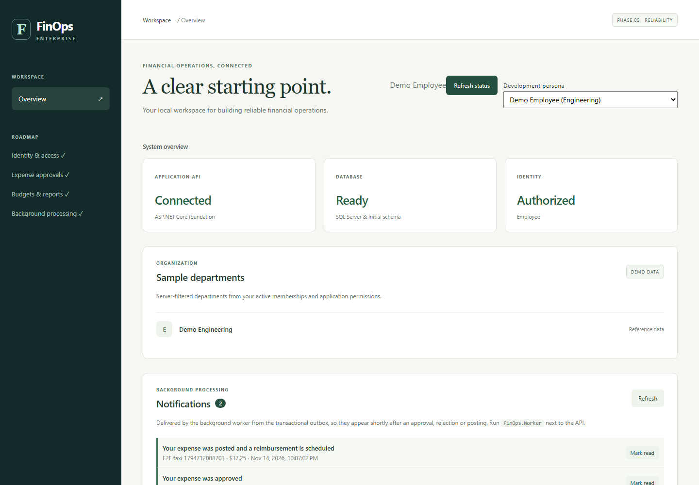
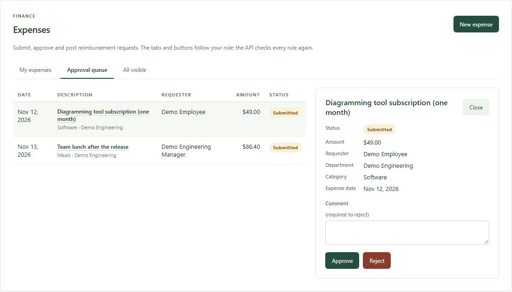
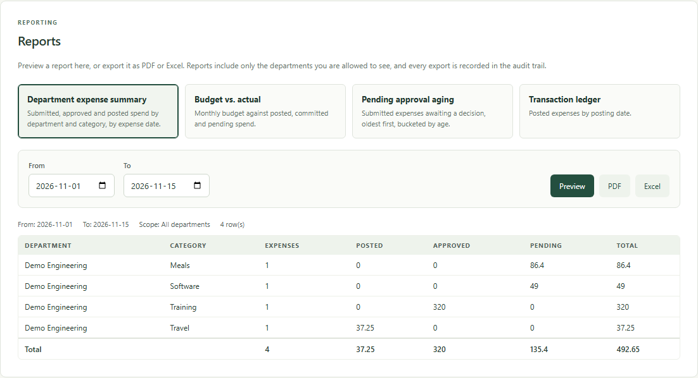
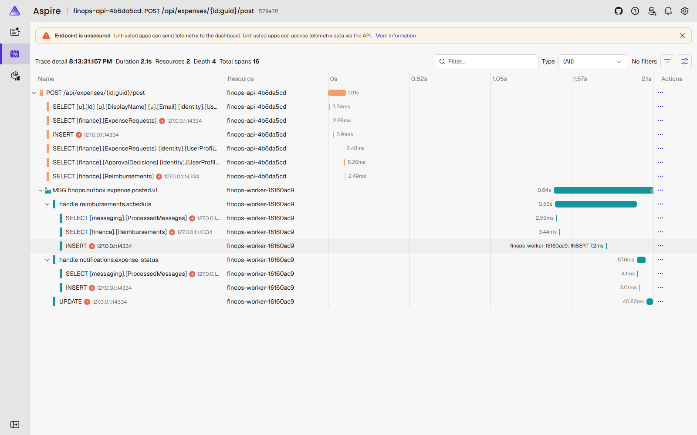

# FinOps Enterprise

[](https://github.com/Ranish-Shrestha/FinOpsEnterprise/actions/workflows/ci.yml)

A portfolio-quality internal financial operations platform: ASP.NET Core 10, Angular 21, SQL Server and Microsoft Entra ID. It is built in vertical phases, and each phase runs end to end and is tested. **Only synthetic data belongs in this project.**

## Status

| Phase | Scope | State |
| --- | --- | --- |
| 1. Foundation | Solution layout, SQL Server, EF migrations, health, OpenAPI, Angular shell | Done |
| 2. Identity and authorization | Entra OIDC/PKCE, JWT validation, app-owned roles, permissions and dated memberships, mock personas | Done; real Entra sign-in not yet verified with a tenant |
| 2.5 Hardening | Demo data out of migrations, per-request access cache, rate limiting, security headers, CI | Done |
| 3a. Expense workflow | Draft → submit → approve/reject → post; separation of duties; ETag concurrency; audit trail; paged API; UI | Done ([design](docs/design/phase3-expenses.md)) |
| 3b. Budgets and SQL | Monthly budgets, budget vs. actual via a stored procedure, covering indexes with execution-plan evidence | Done ([evidence](docs/performance/expense-queries.md)) |
| 4. Reporting | Five reports from parameterized stored procedures, as an in-app preview, PDF or Excel; matching SSRS RDL files; server-side department isolation; audited exports | Done ([ADR 0004](docs/decisions/0004-report-access.md)); RDL files not rendered on a real SSRS server |
| 5. Reliability | Transactional outbox written with each approve/reject/post; background worker with leases, exponential retries, dead-lettering and admin replay; idempotent handlers (one reimbursement per posted expense, in-app notifications) | Done ([ADR 0005](docs/decisions/0005-messaging-outbox.md)); local SQL-backed queue, Azure Service Bus adapter not built |
| 6. Quality and DevOps | Agreed latency targets measured at 60k expenses (enforced in CI); OpenTelemetry traces, metrics and logs across API → SQL → worker, viewable in the Aspire dashboard; Playwright end-to-end journeys in CI | Done ([ADR 0006](docs/decisions/0006-quality-targets-and-telemetry.md)); CI enforcement not yet observed (see [verification](docs/verification.md)) |
| 7. Azure and portfolio | Dockerfile (non-root, chiseled); Bicep for Container Apps (scale to zero), serverless SQL (free offer, Entra-only, managed identity with least-privilege grants), Static Web Apps; OIDC CD workflow gated on CI; runtime SPA config and CORS; screenshots and demo script | Templates and CD done ([ADR 0007](docs/decisions/0007-azure-deployment.md)); **not deployed yet**, by choice |

Full plan: [FINOPS_ENTERPRISE_CODEX_SPEC.md](FINOPS_ENTERPRISE_CODEX_SPEC.md). What has actually been run: [docs/verification.md](docs/verification.md). A guided tour: [docs/demo-walkthrough.md](docs/demo-walkthrough.md).

## Screenshots

All data is synthetic. To regenerate the screenshots, see *End-to-end tests* below.

| | |
| --- | --- |
|  |  |
| *Employee overview: departments filtered by membership, notifications from the worker* | *Manager's approval queue: actions follow role and separation of duties* |
|  |  |
| *Reports preview, with PDF and Excel export; department scope enforced by the API* | *One OpenTelemetry trace: the request, its SQL, then the worker's outbox processing* |

## What this demonstrates so far

- **Authentication separate from authorization.** A valid Entra token identifies the caller. Roles, permissions and department memberships come only from SQL Server, and token role claims are never trusted.
- **Server-side resource filtering.** Department lists are filtered by active, dated memberships before projection. Expired memberships and deactivated users grant nothing.
- **Tests at the right level.**
  - Domain unit tests.
  - HTTP tests for the 401/403/429 matrix.
  - Real SQL Server tests through Testcontainers. EF InMemory is never used.
  - Angular component, service and interceptor tests.
  - Playwright end-to-end journeys against the real API, worker and SQL Server.
  - Latency targets measured at 60,000 expenses, with before/after evidence.
- **Reliable background processing.** Business events are written in the same transaction as the change, delivered at least once by a worker, and handled idempotently. Tests prove no duplicate effect under redelivery, partial failure, expired leases and concurrent workers.
- **Observability.** One OpenTelemetry trace follows a business action from the HTTP request through SQL to the background worker. Outbox backlog, dead letters and delivery latency are metrics.
- **Operational basics.** Liveness and readiness, Problem Details, correlation IDs in structured logs, security headers, rate limiting, and migrations that are never applied automatically.

## Repository layout

```text
src/
  FinOps.Api/              Composition root: endpoints, auth, middleware, health
  FinOps.Application/      Contracts (readers), DTOs, permission catalog
  FinOps.Domain/           Entities and invariants (no framework dependencies)
  FinOps.Infrastructure/   EF Core mappings, migrations, readers, demo seeder, outbox queue and processor
  FinOps.Worker/           Background worker host (delivers outbox messages)
infra/
  main.bicep               Azure: Container Apps, serverless SQL, Static Web App, identity, monitoring
  sql/provision-user.sql   Provision a real Entra user in a deployed database
Dockerfile                API and worker images (targets api, worker)
  finops-web/              Angular standalone SPA
tests/
  FinOps.UnitTests/        Domain invariants
  FinOps.IntegrationTests/ HTTP tests (doubles) + real SQL Server tests (Category=Database)
docs/
  architecture/overview.md        Components, request lifecycle, data model
  architecture/ui-flow.md         UI flow charts: start-up and sign-in, page sections by permission, expense lifecycle
  api/openapi.json                OpenAPI document (kept in sync by a test)
  security/identity-authorization.md  Boundaries, permissions, personas, Entra setup
  design/phase3-expenses.md       Expense and budget rules (accepted)
  performance/expense-queries.md  Execution-plan and HTTP latency evidence, before and after
  operations/observability.md     Telemetry, metrics, suggested alerts
  operations/deployment.md        One-time Azure setup, CD, operating and tearing down
  demo-walkthrough.md             Script for a 6-8 minute demo
  screenshots/                    README images (regenerated by Playwright)
  decisions/                      ADRs 0001–0007
  requirements-review.md          Spec adjustments and open questions
  verification.md                 Dated log of what was run
reports/SSRS/                     RDL report definitions (generated) and deployment notes
.github/workflows/ci.yml          Build, tests, real-SQL tests, EF drift, Angular, E2E, images, Bicep lint, audit
.github/workflows/deploy.yml      CD to Azure after CI passes on main (OIDC, opt-in)
docker-compose.yml                Local SQL Server; optional Aspire dashboard (profile: observability)
```

## Prerequisites

- [.NET 10 SDK](https://dotnet.microsoft.com/en-us/download/dotnet/10.0); `global.json` accepts 10.0.100 or later feature bands.
- [Node.js 22](https://nodejs.org/en/download) (22.12 or newer) with npm 11: `npm install --global npm@11.21.1`.
- Docker Desktop running the **Linux** engine, with at least 2 GB of memory for SQL Server.
- Free ports: 14333 (SQL), 5143 and 7143 (API), 4200 (UI).

Commands below are PowerShell. Run them **one line at a time**, from the repository root unless stated otherwise. On Windows, open the folder with an uppercase drive letter (`F:\...`, not `f:\...`; see Troubleshooting). Mock mode needs no Entra tenant or Azure subscription.

## Quick start (mock identities)

You will end up with **three terminals that stay open**, for the API, the background worker and the UI, while SQL Server runs in Docker in the background. Each long-running command stops when its terminal closes.

| Piece | Runs in | Ready when you see |
| --- | --- | --- |
| SQL Server | Docker (background) | `Container finops-enterprise-sqlserver-1 Healthy` |
| API | Terminal 1 (stays open) | `Now listening on: https://localhost:7143` |
| UI | Terminal 2 (stays open) | `Local: http://127.0.0.1:4200/` |
| Worker | Terminal 3 (stays open) | `Outbox worker started` |

### 1. Start SQL Server (first time)

Start Docker Desktop, then copy the environment file:

```powershell
Copy-Item .env.example .env
```

Edit `.env` and replace the placeholder with your own local password. SQL Server rejects weak passwords and the container exits with code 255. The password needs at least 8 characters, with three of these four: uppercase, lowercase, digits, symbols. Avoid `$`, `;` and quotes.

```powershell
docker compose up -d --wait sqlserver
```

`.env` configures Compose only and is git-ignored. The password is fixed when the data volume is first created; changing `.env` later does not change it. To start over, run `docker compose down --volumes`, which **deletes the local database**, then run `up` again.

### 2. Configure, migrate and seed (first time)

Use the **same password** as in `.env`, and `127.0.0.1` rather than `localhost`. Compose publishes SQL Server on IPv4 only, and `localhost` may resolve to IPv6 first and time out.

```powershell
dotnet dev-certs https --trust
dotnet tool restore
dotnet user-secrets set "ConnectionStrings:FinOps" "Server=127.0.0.1,14333;Database=FinOpsEnterprise;User Id=sa;Password=<YOUR_LOCAL_SQL_PASSWORD>;Encrypt=True;TrustServerCertificate=True;Connect Timeout=5" --project src/FinOps.Api
```

```powershell
$env:ASPNETCORE_ENVIRONMENT = "Development"
dotnet ef database update --project src/FinOps.Infrastructure --startup-project src/FinOps.Api
dotnet run --project src/FinOps.Api -- seed-demo-data
```

Run `database update` **before** `seed-demo-data`: the first creates the tables, the second fills in demo users. It prints how many rows it inserted; running it again prints `0 row(s)`.

- **Configuration.** The API reads the connection string from user secrets or `ConnectionStrings__FinOps`, never from `.env`. `TrustServerCertificate` and the `sa` login are for the local container only.
- **Migrations** create schemas, tables and **reference data** (departments, roles, permissions). They never create user accounts and never run on API startup.
- **`seed-demo-data`** inserts the four synthetic personas below. It runs only in Development, is safe to repeat, and only inserts missing rows.
- **After pulling new migrations:** run `database update`, then `seed-demo-data` again. It adds only what is missing, such as the Phase 3 personas and sample expenses.

### 3. Start the API (terminal 1, leave it open)

```powershell
$env:ASPNETCORE_ENVIRONMENT = "Development"
dotnet run --project src/FinOps.Api --launch-profile https
```

Wait for `Now listening on: https://localhost:7143`. As a check, `https://localhost:7143/health` should return `{"status":"Healthy"}`.

To explore the API, open **https://localhost:7143/swagger**. Choose *Authorize* and paste a persona's object ID into `X-Development-User` (the IDs are listed there), then use *Try it out*.

### 4. Start the UI (terminal 2, leave it open)

```powershell
Set-Location src/finops-web
npm ci        # first time, or after package-lock.json changes
npm start
```

Wait for `Local: http://127.0.0.1:4200/`, then open **http://127.0.0.1:4200**. The dev server proxies `/api` and `/health` to `https://localhost:7143`. Its `secure: false` setting exists only for the local development certificate.

### 4b. Start the background worker (terminal 3, leave it open)

```powershell
dotnet run --project src/FinOps.Worker
```

It uses the same user-secret connection string as the API, and its launch profile sets `DOTNET_ENVIRONMENT=Development`. Wait for `Outbox worker started`. Without it the app still works, but notifications and reimbursements wait in the outbox until the worker runs. You can start more than one: they never claim the same message at once, and a redelivered message never repeats an effect.

### 4c. Optional: watch the telemetry

```powershell
docker compose --profile observability up -d aspire-dashboard
```

Open **http://localhost:18888**. The API and worker launch profiles already export to it. After posting an expense, the *Traces* view shows one trace containing the request, its SQL and the worker's processing. See [observability](docs/operations/observability.md).

### 5. Try the authorization rules

In mock mode, use the **Development persona** picker:

| Persona | Departments | Expenses |
| --- | --- | --- |
| Demo Employee | **Demo Engineering** only | Creates, submits, withdraws and revises their own |
| Demo Engineering Manager | Demo Engineering | Approves or rejects Engineering expenses, but **never their own** |
| Demo Finance Officer | All three | Sees all expenses; posts approved ones, but never their own |
| Demo Manager | **Demo Finance** only (Operations membership expired) | Approves Finance expenses; Engineering expenses are invisible (404) |
| Demo Administrator | All three | Reads all expenses and the audit trail; cannot approve or post |
| Demo Former Employee | Inactive user: no access (403) | No access |

**Walk through the expense flow:**

1. As **Demo Employee**, click *New expense*, create a draft, open it and choose *Submit for approval*.
2. Switch to **Demo Engineering Manager**. Under *Approval queue*, open it and approve it, or reject it with a comment.
3. Switch to **Demo Finance Officer**. Under *Ready to post*, open it and choose *Post to ledger*.
4. As the **Engineering Manager**, open "Team lunch after the release" (their own submitted expense): no approve button is offered, and the API refuses with 403.

The seed data includes an expense in each state, so every view has something to show.

**Background processing:** after the Engineering Manager approves and Finance posts, switch back to **Demo Employee** and press *Refresh* in the *Notifications* panel: "approved" and "posted" notifications appear within a couple of seconds, and the expense shows *Reimbursement: Scheduled*. Stop the worker, post another expense, and the notification waits until you start it again. As **Demo Administrator**, the panel also shows the outbox: pending and dead-lettered counts, with *Replay* for dead letters.

**Reports:** in the *Reports* panel, pick a report, then use *Preview*, *PDF* or *Excel*. As **Demo Manager**, every report contains only Demo Finance, including inside the downloaded files. **Demo Administrator** also gets *Audit activity*. Employees don't see the panel.

**Budgets:** as **Demo Finance Officer**, the *Budget vs. actual* panel shows every department. Use *Set budget* or *Edit* to change a month. As **Demo Manager**, the same panel shows only Demo Finance and has no edit controls. Employees don't see the panel at all.

Then stop the database with `docker compose stop sqlserver` and refresh. The API stays live, readiness reports the database is unavailable, and departments report failure. No fake data is substituted. Start it again with `docker compose up -d --wait sqlserver`.

### Starting again later

Steps 1 and 2 are one-time setup. On later days:

1. Start Docker Desktop, then run `docker compose up -d --wait sqlserver`.
2. In terminal 1, start the API (step 3).
3. In terminal 2, start the UI (step 4, without `npm ci`).
4. In terminal 3, start the worker (step 4b).

After pulling changes that add migrations, run `dotnet ef database update` (as in step 2) before starting the API.

## Real Entra sign-in

1. Register the API and SPA apps.
2. Set the API's token version to v2.
3. Configure the tenant and audience through user secrets.
4. Set `mockMode: false` and the Entra IDs in `src/finops-web/public/config.json`. It overrides `auth.config.ts` at startup.
5. Provision your user by Entra object ID.

Step-by-step: [docs/security/identity-authorization.md](docs/security/identity-authorization.md#entra-registration-real-sso).

## Endpoints

| Endpoint | Auth | Purpose |
| --- | --- | --- |
| `GET /health` | Anonymous | Liveness. 200 while the process runs; never touches SQL |
| `GET /health/ready` | Anonymous | Readiness. 200 only when the migrated schema is queryable, otherwise 503 |
| `GET /openapi/v1.json` | Anonymous, **Development only** | OpenAPI document. A committed copy is in [docs/api/openapi.json](docs/api/openapi.json) |
| `GET /swagger` | Anonymous, **Development only** | Swagger UI. Use *Authorize* with a persona's object ID (`X-Development-User`) or an Entra access token |
| `GET /api/me` | Scope + provisioned active user | Profile, roles, permissions and active department IDs |
| `GET /api/departments` | Scope + `departments.read` | Departments filtered by membership, or all with `departments.read.all` |
| `GET /api/expenses` | Scope + provisioned user | Paged list of visible expenses. Filters: `status`, `departmentId`, `mine`, `sort` (`createdAt`, `submittedAt`, `expenseDate`, `amount`; prefix `-` for descending), `page`, `pageSize` (max 100) |
| `GET /api/expenses/{id}` | Scope + can view | Detail, approval history, `allowedActions`, `ETag` |
| `POST /api/expenses` | `expenses.create` + active membership in the department | Create a draft (201 + `Location` + `ETag`) |
| `PUT /api/expenses/{id}` | `expenses.create`, owner, `If-Match` | Edit a draft |
| `POST /api/expenses/{id}/submit\|withdraw\|cancel\|revise` | `expenses.create`, owner, `If-Match` | Requester's transitions |
| `POST /api/expenses/{id}/approve\|reject` | `expenses.approve`, manager of the department, not the requester, `If-Match` | Decision (`{ "comment": "..." }`; required to reject) |
| `POST /api/expenses/{id}/post` | `expenses.post`, not the requester, `If-Match` | Post an approved expense |
| `GET /api/audit-events` | `audit.read` | Paged audit trail, newest first |
| `GET /api/budgets?year=` | `budgets.read.department` (own departments) or `budgets.read.all` | Monthly budgets with `version` for updates |
| `POST /api/budgets` | `budgets.manage` | Set a department's budget for a month (409 if it exists) |
| `PUT /api/budgets/{id}` | `budgets.manage`, `If-Match` | Change a budget amount |
| `GET /api/budgets/vs-actual?year=&month=` | `budgets.read.department` or `budgets.read.all` | Budget vs. spent (posted), committed (approved) and pending (submitted), per department and month, for the Budgets panel |
| `GET /api/notifications` | Scope + provisioned user | Your newest 50 notifications and unread count. Only ever your own |
| `POST /api/notifications/{id}/read` | Scope + provisioned user | Mark one of yours read (204, idempotent). Anyone else's is 404 |
| `GET /api/messaging/outbox` | `messaging.manage` | Pending and dead-lettered counts and the newest dead letters (no payloads) |
| `POST /api/messaging/outbox/{id}/replay` | `messaging.manage` | Return a dead letter to the queue with the same ID (202). Audited |
| `GET /api/reports` | Scope + provisioned user | The reports you may run, with their parameters and formats |
| `GET /api/reports/{key}?format=json\|pdf\|xlsx` | `reports.read.department` or `reports.read.all`; `audit.read` for `audit-activity` | Run a report: `expense-summary`, `budget-vs-actual`, `approval-aging` or `transaction-ledger` (all with `from`/`to` or `year`/`month`), or `audit-activity`. Files are `no-store` and audited |

Status codes:

- **401:** missing or invalid credentials.
- **400:** validation errors (`errors` keyed by field), or invalid paging, sort or status values.
- **403:** valid caller without the scope, provisioning or permission, or a separation-of-duties violation (for example approving your own expense).
- **404:** the resource doesn't exist **or you may not see it**. The two cases are deliberately indistinguishable, so IDs cannot be probed.
- **409:** the transition isn't valid from the expense's current state.
- **412:** `If-Match` doesn't match the current version: someone else changed the expense. Reload it and retry.
- **428:** `If-Match` is missing on a write.
- **429:** rate limit exceeded (default 120 requests per 60 s per caller on `/api/*`; set `RateLimiting:PermitLimit` and `RateLimiting:WindowSeconds` to change it).
- **500:** Problem Details with a `traceId`, never exception text.

Every response carries `X-Correlation-ID`. A safe inbound value is echoed and added to the log scope.

## Build and test

```powershell
dotnet build FinOpsEnterprise.slnx
dotnet test FinOpsEnterprise.slnx --no-build --filter "Category!=Database"
dotnet test tests/FinOps.IntegrationTests --no-build --filter "Category=Database"   # needs Docker

Push-Location src/finops-web; npm run typecheck; npm test; npm run build; Pop-Location

# Only the latency targets (prints p50/p95; enforced in CI or with FINOPS_PERF_ENFORCE=true)
dotnet test tests/FinOps.IntegrationTests --no-build --filter "Category=Performance"
```

- **Database tests:** each test class gets a disposable SQL Server container. It migrates, then seeds, exactly as in the quick start. They fail rather than skip when Docker is unavailable. The first run pulls about 1.5 GB.
- **HTTP tests** use explicit doubles for persistence. They test routing, authorization wiring and error contracts, not SQL behavior.
- **Performance tests** are part of the database tests. They print p50/p95/p99 per endpoint and this machine's SQL commit latency. They fail only in CI, which is the reference environment for the targets.
- **CI** runs all of the above, plus the EF drift check, the end-to-end tests and a production dependency audit, on every push and pull request.

### End-to-end tests

The Playwright journeys run against a **separate stack**: API on port 5199, UI on port 4300. They never touch a development stack on 4200/7143. You need an empty database, migrated and seeded:

```powershell
dotnet build FinOpsEnterprise.slnx -c Release
$env:E2E_CONNECTION_STRING = "Server=127.0.0.1,14333;Database=FinOpsE2E;User Id=sa;Password=<YOUR_LOCAL_SQL_PASSWORD>;Encrypt=True;TrustServerCertificate=True"
$env:ASPNETCORE_ENVIRONMENT = "Development"; $env:ConnectionStrings__FinOps = $env:E2E_CONNECTION_STRING
dotnet ef database update --project src/FinOps.Infrastructure --startup-project src/FinOps.Api
dotnet run --project src/FinOps.Api -- seed-demo-data
Remove-Item Env:ConnectionStrings__FinOps
Push-Location src/finops-web; npx playwright install chromium; npm run e2e; Pop-Location
```

To regenerate the README screenshots afterwards, run `$env:SCREENSHOTS = "1"; npm run e2e -- screenshots`. That spec is skipped otherwise.

Playwright starts the API and the UI, and its global setup starts the worker. On failure, traces and screenshots are in `src/finops-web/test-results`. Use a separate database, such as `FinOpsE2E` above: the tests add expenses.

## Deploying to Azure

Optional, and it costs money. Everything is in [docs/operations/deployment.md](docs/operations/deployment.md):

- **One-time setup:**
  - a resource group;
  - an OIDC deployment identity (no secrets stored in GitHub);
  - Entra app registrations;
  - repository variables.
- **Then:** every push to `main` that passes CI builds the images, deploys `infra/main.bicep`, migrates the database, deploys the SPA and smoke-tests it.
- **When idle:** the API scales to zero and the free-offer SQL database pauses ([ADR 0007](docs/decisions/0007-azure-deployment.md)).

## Troubleshooting

| Symptom | Cause and fix |
| --- | --- |
| Browser shows `ERR_CONNECTION_REFUSED` at `127.0.0.1:4200` | The UI isn't running. Its terminal was closed, or `npm start` exited with an error. Start it as in step 4 and keep that terminal open |
| UI loads, but API shows *Unavailable* | The API isn't running. Start it as in step 3 and keep that terminal open |
| UI shows database *Needs setup* | SQL Server is stopped (`docker compose up -d --wait sqlserver`), or the migrations were never applied (`dotnet ef database update ...`) |
| `container finops-enterprise-sqlserver-1 exited (255)` | Usually the `.env` password is still the placeholder, or too weak. Check with `docker compose logs sqlserver`. Fix `.env`, then `docker compose down --volumes` and `up` again |
| `Login failed for user 'sa'` | The user-secret password differs from the one the volume was created with. Make them match, or recreate the volume |
| PowerShell `Unexpected token '$env:...'` | Two commands were pasted onto one line. Run each command on its own line |
| Every Angular spec fails with "Vitest failed to find the runner" | Windows shell reported a lowercase drive (`f:\`). Run from a terminal at `F:\...`, such as a plain PowerShell window |
| Database tests time out creating a container | Docker was still starting or pulling the image. Run `docker pull mcr.microsoft.com/mssql/server:2022-CU28-ubuntu-22.04` once, then retry |
| `SqlException ... error: 0 - The wait operation timed out` | `localhost` resolved to IPv6 `::1`, but Compose publishes SQL Server on IPv4 only. Use `Server=127.0.0.1,14333` in the connection string |
| Notifications never appear after approving or posting | The worker isn't running. Start it as in step 4b. If it exits with *Configure ConnectionStrings:FinOps*, it wasn't started in Development (user secrets load only there): use `dotnet run --project src/FinOps.Worker`, or set `$env:DOTNET_ENVIRONMENT = "Development"` |
| Every persona gets 403 | Demo data not seeded. Run `dotnet run --project src/FinOps.Api -- seed-demo-data` |
| 401 with a real Entra token | The token is v1, or the audience doesn't match. See the Entra setup notes on `requestedAccessTokenVersion` and `Security:Audience` |
| API exits at startup about `ConnectionStrings:FinOps` | User secret not set, or `ASPNETCORE_ENVIRONMENT` is not `Development` |

## Stopping

Press Ctrl+C in the API, worker and UI terminals, then run `docker compose stop`. `docker compose down` keeps the data volume. **Add `--volumes` only if you mean to delete the local database.**

## Design records

- [Architecture overview](docs/architecture/overview.md) · [UI flow](docs/architecture/ui-flow.md)
- [ADR 0001: Foundation](docs/decisions/0001-foundation.md)
- [ADR 0002: Entra authentication and application authorization](docs/decisions/0002-identity-authorization.md)
- [ADR 0003: Demo data out of migrations; HTTP hardening](docs/decisions/0003-hardening-and-demo-data.md)
- [ADR 0004: Report access and rendering](docs/decisions/0004-report-access.md)
- [ADR 0005: Transactional outbox and a swappable local queue](docs/decisions/0005-messaging-outbox.md)
- [ADR 0006: Measured targets, OpenTelemetry and end-to-end tests](docs/decisions/0006-quality-targets-and-telemetry.md)
- [ADR 0007: Low-cost Azure deployment](docs/decisions/0007-azure-deployment.md)
- [Deployment](docs/operations/deployment.md) · [Demo walkthrough](docs/demo-walkthrough.md)
- [Observability](docs/operations/observability.md)
- [Requirements review and open questions](docs/requirements-review.md)
