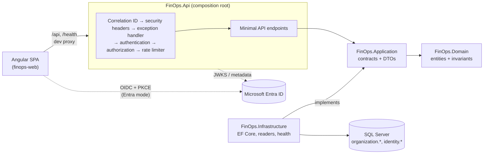
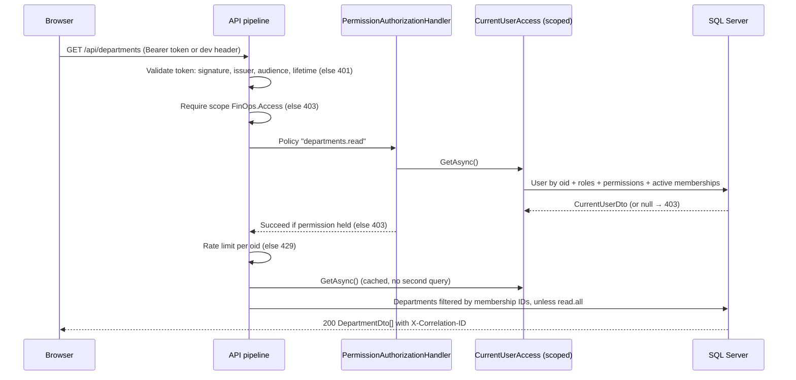
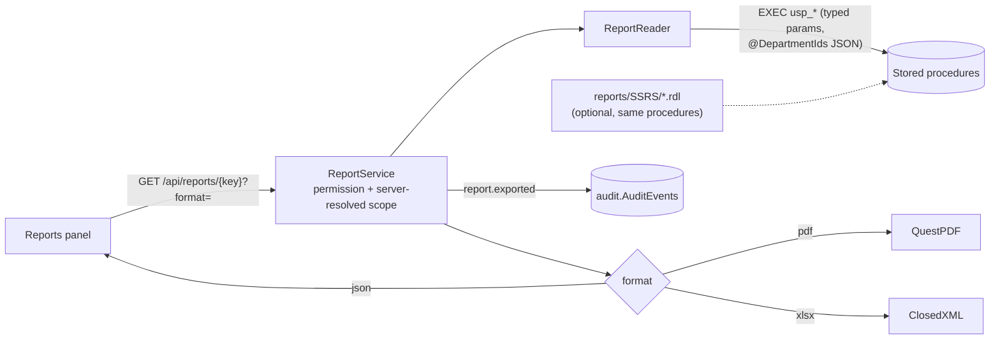
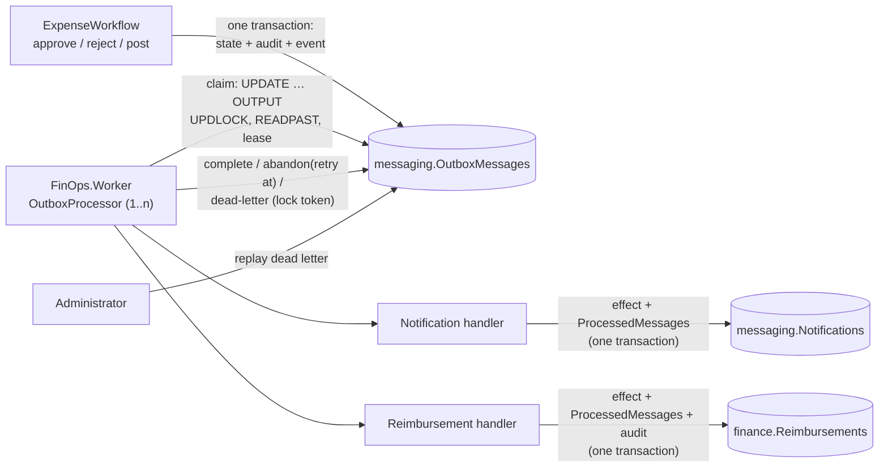

# Architecture overview

FinOps Enterprise is a **modular monolith** with Clean Architecture layering: one deployable API, one background worker, one SPA and one SQL Server database. See [ADR 0001](../decisions/0001-foundation.md) for why it is not split into services.

## Components

Dependencies point inward only. Domain references nothing, Application references Domain, Infrastructure implements Application contracts, and the API wires everything together.

## Request lifecycle: `GET /api/departments`

## Data model (current)

| Schema | Table | Kind | Notes |
| --- | --- | --- | --- |
| `organization` | `Departments` | Reference/demo data | Unique name. Three synthetic rows seeded by migration |
| `identity` | `Roles`, `Permissions`, `RolePermissions` | Reference data | Seeded by migration. Must match `ApplicationPermissions` |
| `identity` | `UserProfiles` | Operational | Unique `EntraObjectId` and `Email`. Never seeded by migration |
| `identity` | `UserRoles` | Operational | |
| `identity` | `DepartmentMemberships` | Operational | Half-open date range. Check constraint `EndsAtUtc > StartsAtUtc` |
| `finance` | `ExpenseRequests` | Operational | `decimal(19,4)`, `rowversion`, status, amount and currency check constraints, approval-queue and requester indexes. No cascade deletes |
| `finance` | `ApprovalDecisions` | Operational, append-only | One row per approve or reject. A rejection must carry a comment (check constraint) |
| `finance` | `Budgets` | Operational | One per department and month (unique), `rowversion`. Actuals are computed by `finance.usp_BudgetVsActual`, never stored |
| `messaging` | `OutboxMessages` | Operational | Business events written with the state change. Lease, lock token, delivery count, retry time and outcome (processed or dead-lettered, never both). Filtered index on the pending backlog |
| `messaging` | `ProcessedMessages` | Operational | Idempotency key: primary key (message ID, handler) |
| `messaging` | `Notifications` | Operational | One per user per source message (unique). IDs only; text is built when read |
| `finance` | `Reimbursements` | Operational | Exactly one per expense (unique `ExpenseRequestId`), created by the worker |
| `audit` | `AuditEvents` | Append-only | Successes and denials, with correlation ID and allow-listed JSON metadata. No foreign keys, so history outlives the rows it describes |

## Operational surface

| Concern | Current implementation |
| --- | --- |
| Liveness / readiness | `/health` (process) and `/health/ready` (queries the mapped schema) |
| Errors | RFC 9457 Problem Details with `traceId`; no exception text |
| Correlation | `X-Correlation-ID`: a safe inbound value is echoed, otherwise the W3C trace ID. Added to every log scope |
| Logging | JSON console with scopes; also exported over OTLP with trace context when telemetry is on |
| Telemetry | OpenTelemetry traces and metrics (ASP.NET Core, SqlClient, runtime, `FinOps` source and meter), opt-in via `OTEL_EXPORTER_OTLP_ENDPOINT`. The worker's spans continue the request's trace. See [observability](../operations/observability.md) |
| Hardening | HSTS (outside Development), `nosniff`, `X-Frame-Options: DENY`, restrictive CSP, `no-store` on `/api` |
| Rate limiting | Fixed window per caller on `/api/*`, configurable via `RateLimiting:PermitLimit` and `RateLimiting:WindowSeconds` |
| CI | `.github/workflows/ci.yml`: locked restore, build, unit and HTTP tests, Testcontainers SQL tests (including the enforced latency targets), EF drift check, Angular checks, Playwright end-to-end journeys, production dependency audit |

## Reporting

All three formats come from one `ReportTable`, so preview, PDF and Excel always agree. See [ADR 0004](../decisions/0004-report-access.md).

## Background processing

Delivery is at least once; each handler's effect is committed at most once per message. See [ADR 0005](../decisions/0005-messaging-outbox.md).

## Planned additions

These are not built yet. They are added in their own phases (see [the spec](../../FINOPS_ENTERPRISE_CODEX_SPEC.md)):

- Azure Service Bus adapter for `IMessageQueue` (optional).
- Azure deployment.
