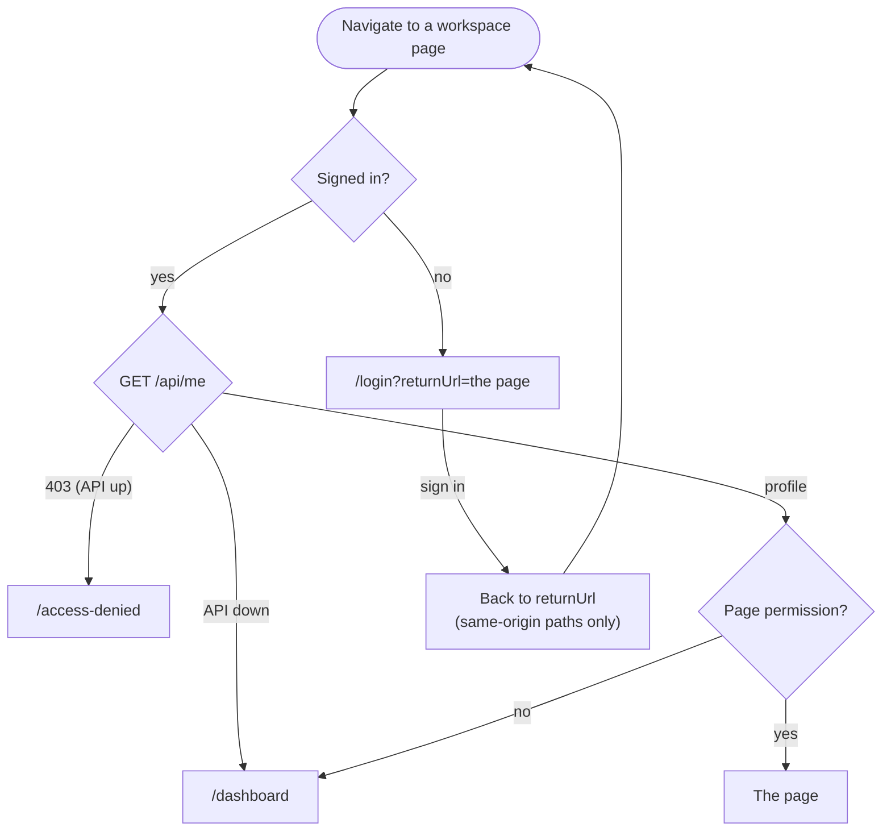
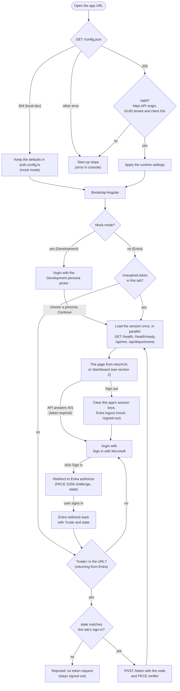
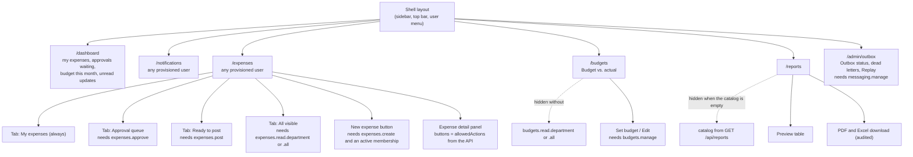
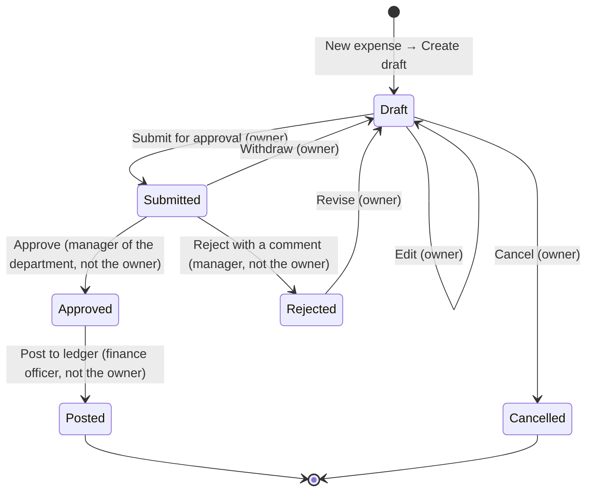
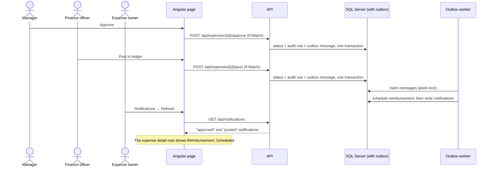

# UI flow

How the Angular app starts, signs in, and decides what each user sees. The app uses the Angular router with two layouts: a centered **auth layout** for the sign-in and account-help pages, and a **shell layout** (sidebar, top bar, user menu) for the workspace pages. Which pages and sections a caller sees depends on the permissions the API returns from `GET /api/me`. See [ADR 0008](../decisions/0008-client-routing.md).

The UI never decides access on its own. Hiding a button is a convenience: the API checks every request again, and returns 403 for anything the caller may not do.

Source: [main.ts](../../src/finops-web/src/main.ts), [app.config.ts](../../src/finops-web/src/app/app.config.ts), [app.routes.ts](../../src/finops-web/src/app/app.routes.ts), [core/guards.ts](../../src/finops-web/src/app/core/guards.ts), [auth.service.ts](../../src/finops-web/src/app/auth.service.ts) and the feature folders under [src/finops-web/src/app](../../src/finops-web/src/app).

## Pages and routes

| Route | Layout | Guard | Page |
| --- | --- | --- | --- |
| `/login` | Auth | signed out only | *Sign in with Microsoft* (Entra SSO). In mock mode: persona picker and *Continue* |
| `/signup` | Auth | signed out only | *Request access*: there is no self-service sign-up, because an administrator provisions accounts |
| `/forgot-password` | Auth | none | Link to Entra self-service password reset. We never store passwords |
| `/mfa` | Auth | none | MFA is enforced by Entra Conditional Access; link to Microsoft security info |
| `/access-denied` | Auth | none | Signed in, but no active FinOps profile (`/api/me` 403); shows the Object ID to send to an administrator |
| `/signed-out` | Auth | none | Confirmation, and *Sign in again* |
| `/dashboard` | Shell | signed in | The user's work by role: counts, approvals waiting, recent expenses, this month's budget, unread updates; system status on one line |
| `/expenses`, `/expenses/:id` | Shell | signed in | Expenses. The tab is `?view=mine\|queue\|toPost\|all`; `:id` opens the detail pane |
| `/budgets` | Shell | `budgets.read.department` or `.all` | Budget vs. actual |
| `/reports` | Shell | `reports.read.department`, `.all` or `audit.read` | Reports |
| `/notifications` | Shell | signed in | Notifications |
| `/admin/outbox` | Shell | `messaging.manage` | Outbox status, dead letters, Replay |
| anything else | Auth | none | Page not found |

The guards only choose a page. The sidebar uses the same permission lists ([core/permissions.ts](../../src/finops-web/src/app/core/permissions.ts)), and the API still authorizes every request. Switching persona in mock mode re-runs the guards, so a page the new persona may not use redirects to the dashboard.

## 1. Start-up and sign-in

The Entra redirect still returns to the site root (`/`), so the app registration doesn't change. An app initializer exchanges the code before the router starts, then replaces the address with the saved `returnUrl`.

What the caller sees before and after access is known:

| Situation | What the user sees |
| --- | --- |
| API or SQL Server down | Dashboard panels say they couldn't load; the status line shows *API unavailable* or *Database not ready* |
| Signed in, but no application profile, or the profile is inactive (`/api/me` is 403) | `/access-denied`, with the account's Object ID to provision |
| Signed in and provisioned | The dashboard tiles and panels their permissions allow (section 2); each panel loads separately, so one failure doesn't blank the page |

## 2. Workspace pages and what controls each section

### Who sees what (demo personas)

From the seeded roles and memberships (`seed-demo-data`):

| Persona | Role | Departments | Expense tabs | New expense | Budgets | Reports | Outbox |
| --- | --- | --- | --- | --- | --- | --- | --- |
| Demo Employee | Employee | Engineering | My expenses | Yes | Hidden | Hidden | Hidden |
| Demo Engineering Manager | Manager | Engineering | My expenses, Approval queue, All visible | Yes | Engineering, read only | 4, Engineering only | Hidden |
| Demo Manager | Manager | Finance (Operations expired) | My expenses, Approval queue, All visible | Yes | Finance, read only | 4, Finance only | Hidden |
| Demo Finance Officer | FinanceOfficer | Finance | My expenses, Ready to post, All visible | Yes | All, can set budgets | 4, all departments | Hidden |
| Demo Administrator | Administrator | None (global read) | My expenses, All visible | No | All, read only | All 5, including *Audit activity* | Yes, with Replay |
| Demo Former Employee | Employee (inactive) | Engineering | None: `/api/me` is 403 | No | Hidden | Hidden | Hidden |

The four reports open to managers and finance are *Department expense summary*, *Budget vs. actual*, *Pending approval aging* and *Transaction ledger*. *Audit activity* needs `audit.read`.

## 3. An expense from draft to reimbursement

The buttons in the detail panel come from the API's `allowedActions` for that caller and that expense. The domain enforces the same rules, including separation of duties: nobody approves or posts their own expense.

Every change sends `If-Match` with the expense's ETag. If someone else changed it first, the UI shows *Modified by someone else* (412), and the user reloads and decides again.

After a decision or a posting, the background work shows up later in the page:

## Related

- [Architecture overview](overview.md)
- [Identity and authorization](../security/identity-authorization.md)
- [Demo walkthrough](../demo-walkthrough.md), a scripted tour of these screens
- API reference: Swagger UI at `https://localhost:7143/swagger` when the API runs in Development, or [docs/api/openapi.json](../api/openapi.json)
