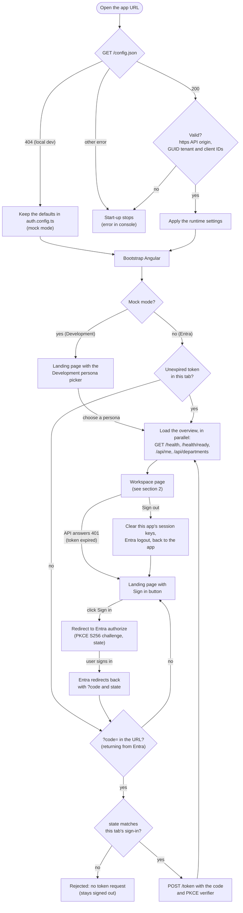
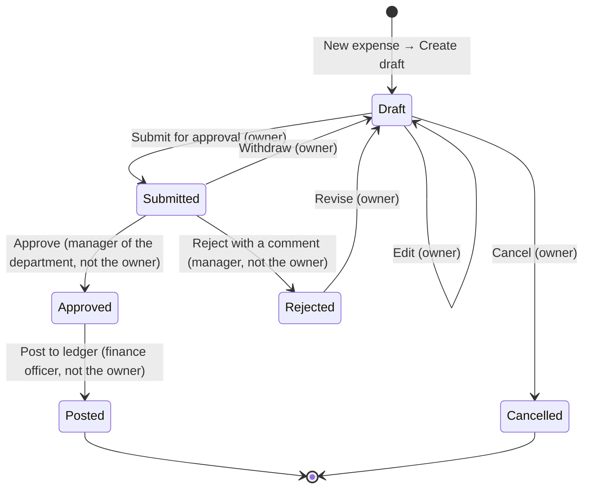
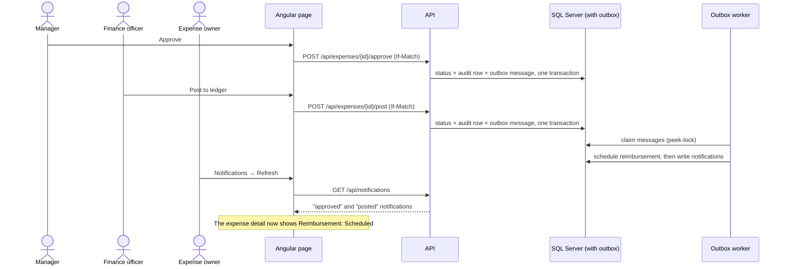

# UI flow

How the Angular app starts, signs in, and decides what each user sees. The app is a **single page** with no client-side routes: the landing page is the workspace, and each section appears or hides according to the caller's permissions, which the API returns from `GET /api/me`.

The UI never decides access on its own. Hiding a button is a convenience: the API checks every request again, and returns 403 for anything the caller may not do.

Source: [main.ts](../../src/finops-web/src/main.ts), [app.html](../../src/finops-web/src/app/app.html), [auth.service.ts](../../src/finops-web/src/app/auth.service.ts) and the feature folders under [src/finops-web/src/app](../../src/finops-web/src/app).

## 1. Start-up and sign-in (the landing page)

What the landing page shows before and after access is known:

| Situation | System overview cards | Rest of the page |
| --- | --- | --- |
| API or SQL Server down | *Unavailable* or *Needs setup* | "We couldn't load the departments", with setup hints |
| Signed in, but no application profile, or the profile is inactive (`/api/me` is 403) | Identity: *Sign in*, "No application access" | Expenses says "Sign in with an active account to see expenses"; the other feature sections stay hidden |
| Signed in and provisioned | Identity: *Authorized*, with the user's roles | Sections allowed by their permissions (section 2) |

## 2. The workspace page and what controls each section

```mermaid
flowchart TD
  Page["Workspace page<br/>(sidebar, header, Refresh status)"] --> Overview["System overview<br/>API, database, identity cards"]
  Page --> Depts["Sample departments<br/>server-filtered by membership"]
  Page --> Activity["Notifications<br/>shown to any provisioned user"]
  Page --> Expenses["Expenses<br/>shown to any provisioned user"]
  Page --> Budgets["Budget vs. actual"]
  Page --> Reports["Reports"]

  Activity --> Outbox["Outbox status, dead letters, Replay<br/>needs messaging.manage"]

  Expenses --> Mine["Tab: My expenses (always)"]
  Expenses --> Queue["Tab: Approval queue<br/>needs expenses.approve"]
  Expenses --> ToPost["Tab: Ready to post<br/>needs expenses.post"]
  Expenses --> All["Tab: All visible<br/>needs expenses.read.department or .all"]
  Expenses --> New["New expense button<br/>needs expenses.create and an active membership"]
  Expenses --> Detail["Expense detail panel<br/>buttons = allowedActions from the API"]

  Budgets -.->|"hidden without"| BRead["budgets.read.department or .all"]
  Budgets --> SetBudget["Set budget / Edit<br/>needs budgets.manage"]

  Reports -.->|"hidden when the catalog is empty"| RCat["catalog from GET /api/reports"]
  Reports --> Preview["Preview table"]
  Reports --> Export["PDF and Excel download (audited)"]
```

### Who sees what (demo personas)

From the seeded roles and memberships (`seed-demo-data`):

| Persona | Role | Departments | Expense tabs | New expense | Budgets | Reports | Outbox |
| --- | --- | --- | --- | --- | --- | --- | --- |
| Demo Employee | Employee | Engineering | My expenses | Yes | Hidden | Hidden | Hidden |
| Demo Engineering Manager | Manager | Engineering | My expenses, Approval queue, All visible | Yes | Engineering, read only | 4, Engineering only | Hidden |
| Demo Manager | Manager | Finance (Operations expired) | My expenses, Approval queue, All visible | Yes | Finance, read only | 4, Finance only | Hidden |
| Demo Finance Officer | FinanceOfficer | Finance | My expenses, Ready to post, All visible | Yes | All, can set budgets | 4, all departments | Hidden |
| Demo Administrator | Administrator | None (global read) | My expenses, All visible | No | All, read only | All 5, including *Audit activity* | Yes, with Replay |
| Demo Former Employee | Employee (inactive) | Engineering | None: `/api/me` is 403 | No | Hidden | Hidden | Hidden |

The four reports open to managers and finance are *Department expense summary*, *Budget vs. actual*, *Pending approval aging* and *Transaction ledger*. *Audit activity* needs `audit.read`.

## 3. An expense from draft to reimbursement

The buttons in the detail panel come from the API's `allowedActions` for that caller and that expense. The domain enforces the same rules, including separation of duties: nobody approves or posts their own expense.

Every change sends `If-Match` with the expense's ETag. If someone else changed it first, the UI shows *Modified by someone else* (412), and the user reloads and decides again.

After a decision or a posting, the background work shows up later in the page:

## Related

- [Architecture overview](overview.md)
- [Identity and authorization](../security/identity-authorization.md)
- [Demo walkthrough](../demo-walkthrough.md), a scripted tour of these screens
- API reference: Swagger UI at `https://localhost:7143/swagger` when the API runs in Development, or [docs/api/openapi.json](../api/openapi.json)
