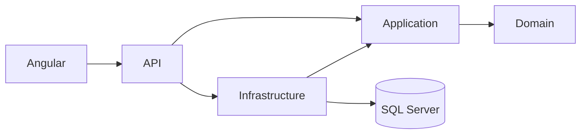

# ADR 0001: Phase 1 foundation

Status: accepted for the local foundation.

## Decision

Use one ASP.NET Core host and four projects with inward dependencies:

Domain has no package or framework dependencies. Application owns read contracts and DTOs. Infrastructure implements these contracts with EF Core. API is the composition root. A single scoped DbContext provides the persistence boundary; a generic repository, mediator, event bus and separate services would add no value to this phase.

Use minimal APIs consistently. Small endpoint handlers delegate persistence through application interfaces and return DTOs. No external consumer/version compatibility requirement exists yet, so the business API is not versioned.

Use a minimal organization module with a Department entity and three fixed synthetic seed records. An explicit EF migration creates the schema, constraints, index and seed data. Seed IDs are fixed to prevent migration churn. The query is no-tracking, ordered, projected and capped at 50. This is a development connectivity sample, not the final authorized department-list API.

The application never migrates a database during startup. Migration execution remains an explicit developer/operator step. This avoids startup races and accidental schema changes when later deployment work is introduced.

Expose separate liveness and readiness endpoints. Readiness queries the mapped department table so an unmigrated SQL Server cannot report ready. Both return status only. A stopped database does not make the API's liveness fail.

Development sample data and OpenAPI are mapped only in Development. HTTPS is used for the API; the Angular development server proxies same-origin relative requests, avoiding broad CORS configuration. No mock authentication or financial write endpoints are included.

Use Angular standalone components, signals for UI state, HttpClient and an explicit service boundary. The shell reflects actual responses and shows unavailable/empty/loading states. It has no chart, revenue figure or active workflow that implies later features are already implemented.

Use built-in JSON logging and Problem Details for the foundation. Serilog, telemetry exporters and distributed processing are added only when their later-phase behavior is being implemented.

## Consequences

- Layers can grow independently without deploying separate services.
- SQL Server remains the database under test; HTTP tests use clearly scoped doubles only.
- Docker is necessary for database acceptance tests, but not HTTP tests or liveness.
- No paid infrastructure, tenant registration or SSRS installation is needed.
- Full readiness for Phase 1 still requires the documented API/UI/SQL smoke test.
- Phase 2 must replace the development sample with permission-aware endpoints before business data is exposed.
