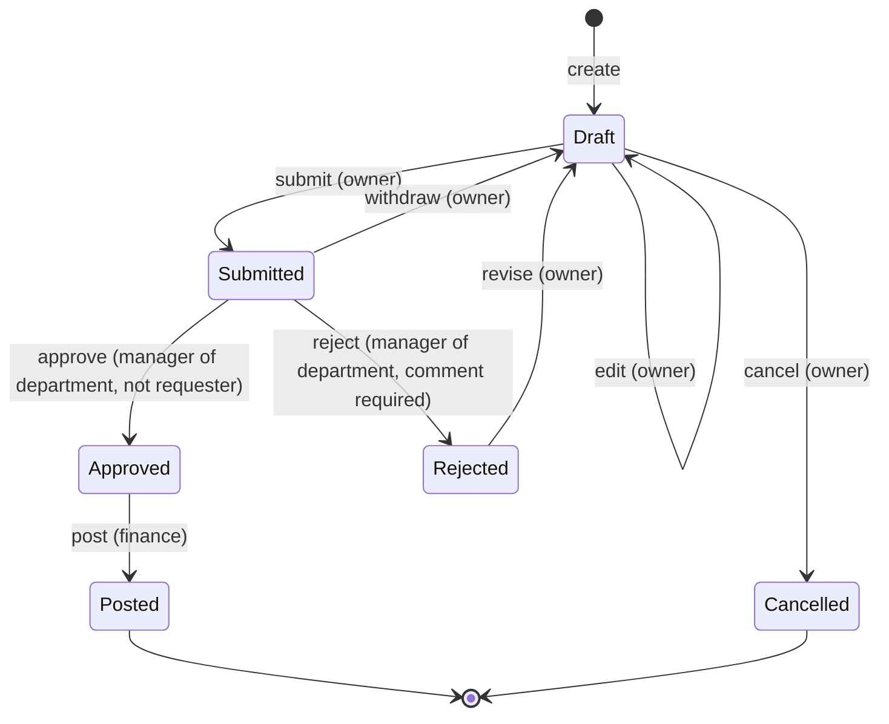

# Phase 3 design: expenses and approvals

Status: **accepted and implemented (2026-11-14)**. Round 3a covers the expense workflow; round 3b covers budgets, the budget-vs-actual stored procedure and execution-plan evidence.

This document resolves the Phase 3 questions in [requirements-review.md](../requirements-review.md), so that implementation starts from explicit rules.

**Decisions taken (2026-11-14):**

- **Administrators do not approve.** Only Managers approve, in their own departments. No `expenses.approve.any` permission exists.
- **USD only.** Every expense stores an ISO currency code, but validation accepts only `USD`. No exchange rates.
- **Posting separation.** Finance also cannot post their own expense, mirroring the approval rule.
- **Seed and roles.** `FinanceOfficer` also has `departments.read.all` so finance can see the whole organization. Demo personas *Demo Finance Officer* and *Demo Engineering Manager* were added so the full flow can be demonstrated.

## Expense state machine

| Transition | Actor and permission | Resource rules | Invalid → |
| --- | --- | --- | --- |
| create | `expenses.create` | Department must be one of the caller's **active** memberships | 403 |
| edit, submit, withdraw, cancel, revise | owner + `expenses.create` | Caller is the requester. State is as shown in the diagram | 404 if not visible, 409 if wrong state |
| approve, reject | `expenses.approve` | Active membership in the expense's department. **Requester ≠ approver** | 403 self-approval, 409 wrong state |
| post | `expenses.post` | State is `Approved` | 409 |

- **Visibility (prevents IDOR).** A caller can read an expense if they own it, have `expenses.read.department` and an active membership in its department, or have `expenses.read.all`. An invisible expense returns **404, not 403**, so IDs cannot be probed.
- **Self-approval** is always forbidden. Administrators do not approve (decided).
- **Transitions are domain methods** on `ExpenseRequest` (`Submit()`, `Approve(approverId, now)`, and so on) that throw a domain exception on an invalid state. Unit-test every cell of the table.

## Money

- **Amounts:** `decimal(19,4)` in SQL and `decimal` in C#. Never `double`. A positive-amount check constraint.
- **Currency:** an ISO 4217 three-letter code, stored per expense with a check constraint `LEN = 3`. Only `USD` is accepted (decided). Multi-currency would need FX rates and reporting rules.
- **Rounding:** store what was submitted, validated to at most 2 decimal places for `USD`. Aggregate in SQL. Round only for display, using banker's rounding (`MidpointRounding.ToEven`) consistently in C# and reports.
- **Timestamps:** `datetimeoffset` in UTC only, as with memberships.

## Concurrency

- `ExpenseRequest` has a `rowversion` concurrency token.
- Clients send the version they read in an `If-Match` header (ETag = base64 rowversion). Responses return `ETag`.
- A stale version returns **412 Precondition Failed** with Problem Details. A missing `If-Match` on a state change returns **428 Precondition Required**.
- Required test: two managers approve the same expense in parallel. Exactly one gets 200, the other gets 412, and exactly one `ApprovalDecision` row exists.

## API conventions (apply to all future collections)

- **Pagination:** `?page=1&pageSize=25`. `pageSize` max 100; larger values are rejected with 400, not clamped. The response envelope is `{ items, page, pageSize, totalCount }`.
- **Sorting:** `?sort=submittedAt` or `?sort=-amount`, from an allow-list per endpoint. Unknown fields return 400.
- **Filtering:** typed query parameters only (`status`, `departmentId`). The authorization filter is applied **before** user filters, and a `departmentId` filter can only narrow visible results, never widen them.
- **Validation:** request DTOs are validated at the endpoint and return 400 `ValidationProblemDetails`.
- `/api/departments` keeps returning a plain array for now. Department counts are tiny; it moves to the envelope when departments get an admin feature.

## Audit (ships with the first mutation, not in Phase 5)

- **`audit.AuditEvents`:** `Id`, `OccurredAtUtc`, `ActorUserId`, `Action` (for example `expense.approved`), `ResourceType`, `ResourceId`, `Outcome`, `CorrelationId`, and `Metadata` (a small allow-listed JSON).
- **What is recorded:** every state transition and every authorization denial on a mutation.
- **Never recorded:** tokens, free-text descriptions, or attachment contents.
- The audit row is written in the **same transaction** as the state change. Phase 5 adds the outbox and Service Bus publication.

## New permissions (migration reference data)

| Permission | Employee | Manager | Finance | Admin |
| --- | --- | --- | --- | --- |
| `expenses.create` | Yes | Yes | Yes | |
| `expenses.read.department` | | Yes | | |
| `expenses.read.all` | | | Yes | Yes |
| `expenses.approve` | | Yes | | |
| `expenses.post` | | | Yes | |
| `audit.read` | | | | Yes |

This needs a new `FinanceOfficer` role with its own reference-data migration and a demo persona in `DemoDataSeeder`.

## Implementation map (round 3a)

| Concern | Where |
| --- | --- |
| State machine and money rules | `FinOps.Domain/Expenses/ExpenseRequest.cs` |
| Who may see and do what | `FinOps.Application/Expenses/ExpenseAccessPolicy.cs` (the SQL list filter in `ExpenseReader` mirrors `CanView`) |
| Use-case orchestration: 404 → 403 → 412 → 409 → 400 order, audit | `FinOps.Application/Expenses/ExpenseWorkflow.cs` |
| Persistence, rowversion guard, one transaction per command | `FinOps.Infrastructure/Persistence/ExpenseStore.cs` |
| Schema, check constraints, indexes | `ExpenseConfiguration.cs`, migration `ExpenseWorkflow` |
| HTTP mapping, If-Match, Problem Details | `FinOps.Api/ExpenseEndpoints.cs` |
| UI | `finops-web/src/app/expenses/` |

## Budgets (round 3b)

- **One budget per department per calendar month** (`finance.Budgets`, unique `DepartmentId, Year, Month`), in USD. Amounts are greater than 0, at most 100,000,000, with 2 decimal places.
- **Who can do what:** finance (`budgets.manage`) creates and changes budgets, using `If-Match` versions and an audit row (`budget.created`, `budget.updated`). Managers read their departments' budgets; finance and administrators read all.
- **Actuals are computed, never stored,** by `finance.usp_BudgetVsActual(@Year, @Month = NULL, @DepartmentIds = NULL)`. They are counted by **expense date** (when the cost was incurred):
  - Spent = Posted
  - Committed = Approved
  - Pending = Submitted, shown but not subtracted
  - Remaining = Budget − Spent − Committed
  - Utilization = (Spent + Committed) ÷ Budget, to one decimal place
- **Unbudgeted spend** is reported with a null budget rather than hidden.
- **The procedure is defined in migration `BudgetsAndReporting`.** A future change to it must ship as a new migration with a new definition, never by editing the old one.

## Indexes, justified with execution plans (round 3b)

Measured results and analysis are in [performance/expense-queries.md](../performance/expense-queries.md). The original plan, which the measurements revised:

- `Expenses (DepartmentId, Status, SubmittedAtUtc)` for the manager queue.
- `Expenses (RequesterId, CreatedAtUtc)` for "my expenses".

Capture plans before and after each index, as the spec §7 asks.
