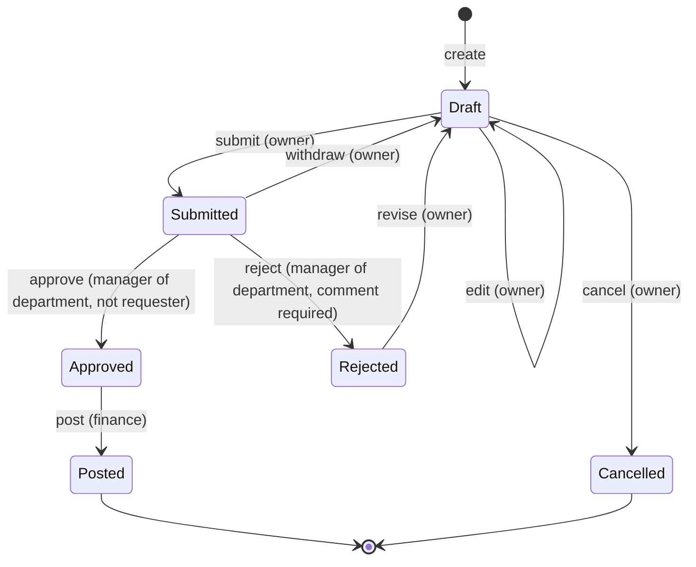

# Phase 3 design: expenses and approvals

Status: **proposed**. Review and adjust before implementation. Anything marked *Decision needed* must be settled first.

This document resolves the Phase 3 questions in [requirements-review.md](../requirements-review.md), so that implementation starts from explicit rules.

## Expense state machine

| Transition | Actor and permission | Resource rules | Invalid → |
| --- | --- | --- | --- |
| create | `expenses.create` | Department must be one of the caller's **active** memberships | 403 |
| edit, submit, withdraw, cancel, revise | owner + `expenses.create` | Caller is the requester. State is as shown in the diagram | 404 if not visible, 409 if wrong state |
| approve, reject | `expenses.approve` | Active membership in the expense's department. **Requester ≠ approver** | 403 self-approval, 409 wrong state |
| post | `expenses.post` | State is `Approved` | 409 |

- **Visibility (prevents IDOR).** A caller can read an expense if they own it, have `expenses.read.department` and an active membership in its department, or have `expenses.read.all`. An invisible expense returns **404, not 403**, so IDs cannot be probed.
- **Self-approval** is always forbidden in this phase. *Decision needed:* whether Administrator may approve (spec says "Configurable"). Proposal: no, until there is an explicit `expenses.approve.any` permission.
- **Transitions are domain methods** on `ExpenseRequest` (`Submit()`, `Approve(approverId, now)`, and so on) that throw a domain exception on an invalid state. Unit-test every cell of the table.

## Money

- **Amounts:** `decimal(19,4)` in SQL and `decimal` in C#. Never `double`. A positive-amount check constraint.
- **Currency:** an ISO 4217 three-letter code, stored per expense with a check constraint `LEN = 3`. *Decision needed:* a single currency (proposal: `USD` only, enforced in validation) versus multi-currency. Multi-currency needs FX rates and reporting rules. Defer it.
- **Rounding:** store what was submitted, validated to at most 2 decimal places for `USD`. Aggregate in SQL. Round only for display, using banker's rounding (`MidpointRounding.ToEven`) consistently in C# and reports.
- **Timestamps:** `datetimeoffset` in UTC only, as with memberships.

## Concurrency

- `ExpenseRequest` has a `rowversion` concurrency token.
- Clients send the version they read in an `If-Match` header (ETag = base64 rowversion). Responses return `ETag`.
- A stale version returns **412 Precondition Failed** with Problem Details. A missing `If-Match` on a state change returns **428 Precondition Required**.
- Required test: two managers approve the same expense in parallel. Exactly one gets 200, the other gets 412, and exactly one `ApprovalDecision` row exists.

## API conventions (apply to all future collections)

- **Pagination:** `?page=1&pageSize=25`. `pageSize` max 100; larger values are rejected with 400, not clamped. The response envelope is `{ items, page, pageSize, totalCount }`.
- **Sorting:** `?sort=submittedAt` or `?sort=-amount`, from an allow-list per endpoint. Unknown fields return 400.
- **Filtering:** typed query parameters only (`status`, `departmentId`). The authorization filter is applied **before** user filters, and a `departmentId` filter can only narrow visible results, never widen them.
- **Validation:** request DTOs are validated at the endpoint and return 400 `ValidationProblemDetails`.
- Once expenses exist, `/api/departments` adopts the same envelope.

## Audit (ships with the first mutation, not in Phase 5)

- **`audit.AuditEvents`:** `Id`, `OccurredAtUtc`, `ActorUserId`, `Action` (for example `expense.approved`), `ResourceType`, `ResourceId`, `Outcome`, `CorrelationId`, and `Metadata` (a small allow-listed JSON).
- **What is recorded:** every state transition and every authorization denial on a mutation.
- **Never recorded:** tokens, free-text descriptions, or attachment contents.
- The audit row is written in the **same transaction** as the state change. Phase 5 adds the outbox and Service Bus publication.

## New permissions (migration reference data)

| Permission | Employee | Manager | Finance | Admin |
| --- | --- | --- | --- | --- |
| `expenses.create` | Yes | Yes | Yes | |
| `expenses.read.department` | | Yes | | |
| `expenses.read.all` | | | Yes | Yes |
| `expenses.approve` | | Yes | | |
| `expenses.post` | | | Yes | |
| `audit.read` | | | | Yes |

This needs a new `FinanceOfficer` role with its own reference-data migration and a demo persona in `DemoDataSeeder`.

## Indexes to justify with execution plans

- `Expenses (DepartmentId, Status, SubmittedAtUtc)` for the manager queue.
- `Expenses (RequesterId, CreatedAtUtc)` for "my expenses".

Capture plans before and after each index, as the spec §7 asks.
